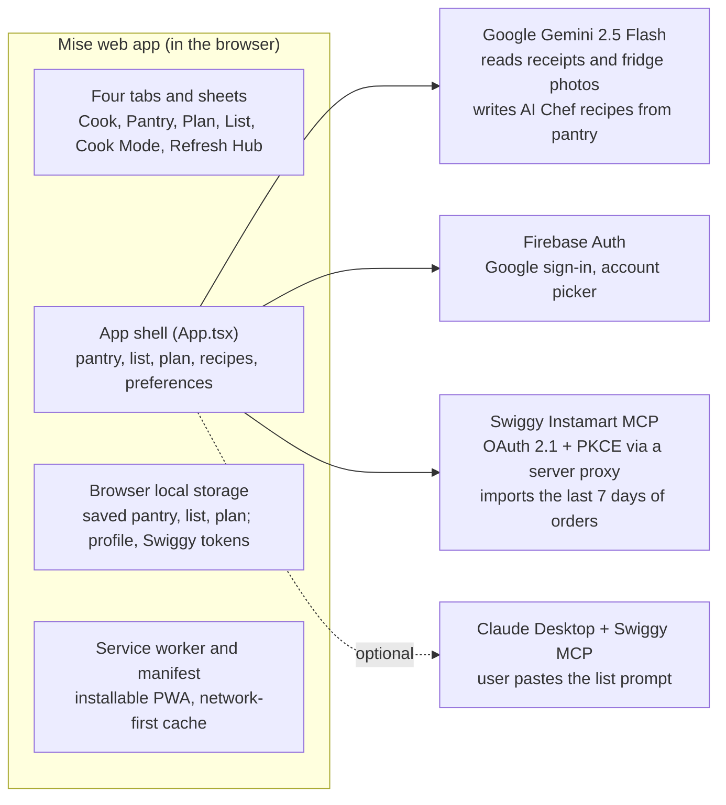

# Mise — Six-Page Narrative

As of 31 Oct 2026 · Owner: Dipayan Ghatak
Editable source: [Claude Doc](https://claude.ai/artifact/LFP4TD52K5jofqW3xAzb74)

## 1. Introduction

Mise is an AI sous-chef that turns the food already in your kitchen into meals you can cook tonight. It keeps a live pantry, ranks recipes by how many ingredients you already own, plans the week, and builds a shopping list for the gaps.

The product today is a React progressive web app (installable, mobile-first, with a desktop sidebar layout) backed by Google Gemini 2.5 Flash for vision and recipe generation, Firebase for Google sign-in, and a live OAuth connection to Swiggy Instamart's MCP server to import recent grocery orders. The latest release (31 Oct 2026) added the launch must-haves: saved data, real expiry dates, manual pantry editing, an "I cooked this" step, working timers, week-level shopping and diet preferences.

This narrative explains what Mise does, how it is built, where it stands, and what it should do next. It is written from the codebase as of the latest commit on `main`.

## 2. Tenets

These are inferred from how the product is built; they guide trade-offs unless we decide otherwise.

1. **Start from what you have.** Every recipe surface is sorted by ingredients owned, not by popularity. Shopping is the fallback, not the default.
2. **Stocking the pantry must take seconds.** If keeping inventory feels like data entry, people stop. Scan, snap or connect; never type a list.
3. **Waste is the enemy.** Items expiring within 3 days are surfaced first, before anything else in the pantry.
4. **The app works before the AI does.** A curated recipe set, sample pantry and demo modes mean a new user sees value with no setup and no API calls.
5. **One calm screen per job.** Cook, Pantry, Plan, List: four tabs, each answering one question.

## 3. The customer problem and where we are

**The customer** is a busy home cook, initially in urban India, who buys groceries through quick-commerce apps (Swiggy Instamart, Blinkit, Zepto) and cooks a few times a week.

**The problem** has three parts:

- **Decision fatigue.** At 7 pm the question is not "what is a good recipe" but "what can I make with what is in my fridge right now". Recipe apps answer the first question.
- **Waste.** Produce and proteins expire before they are used because nobody remembers they are there.
- **Unnecessary trips.** People reorder things they already own, or abandon a recipe because one item is missing.

**Why now.** Two shifts make this solvable. Multimodal models can read a crumpled receipt or a fridge photo and return structured ingredients. Quick-commerce apps now expose order history through MCP servers, so the pantry can fill itself from purchases.

**State of the product.** Mise has gone through 16 commits and 4 merged pull requests, from a "PantryPal" recipe-generator prototype to a branded, installable app:

| Date | Milestone |
| --- | --- |
| 31 Oct 2026 | Launch must-haves: data saved on device, use-by dates, pantry editing, "I cooked this", running timers, shop-for-the-week, bought-to-pantry, diet and allergy preferences |
| 8 Aug 2026 | Weekly planner redesign (real dates, swimlanes, Cook / Order in / Eat out), production hardening |
| 8 Aug 2026 | Live Swiggy Instamart MCP integration (OAuth 2.1 + PKCE) |
| Earlier | Google-only sign-in via Firebase; rebrand from PantryPal to Mise |
| Earlier | PWA conversion with desktop sidebar; vision-based grocery scanning; three visual themes |
| Start | React web app plus a native Android (Jetpack Compose) port of the original PantryPal |

There is no usage data yet: no analytics and no backend. User data is saved on the device only, so it does not follow you to a second phone or computer. The product is pre-launch.

## 4. The product: how it works

Mise is organised around one loop: **stock the pantry → pick a recipe you can make → cook it → shop only for gaps.** Four tabs carry that loop, plus a set of sheets that open on top.

### Sign-in and first run

- **Google sign-in** through Firebase, with an account picker and a redirect fallback when pop-ups are blocked. If Firebase keys are absent, a local mock sign-in keeps the app usable.
- **Onboarding** is a 3-slide overlay ("Dinner from what you already have", "Stock your pantry in seconds", "Plan the week, use it all up"). It sits on top of the working app and has a "Don't show this again" option.
- A new user starts with a sample pantry of 23 items, 8 curated recipes, a sample week plan and a short shopping list, so every screen has content on day one.

### Cook tab — "what can I make right now?"

- Greets the signed-in user by first name and time of day, and shows how many recipes are ready to cook.
- Every recipe card shows a readiness badge: **Ready** or **Need N**, plus "X/Y have". Cards are sorted with the fewest missing ingredients first.
- Filters: All, Ready to cook, Almost there, Quick, Breakfast.
- **AI Chef** button sends the whole pantry to Gemini and returns 2 new recipes that use only what is on hand plus basic staples. They join the top of the list and the first one opens automatically. It follows your diet and allergy settings and favours items about to expire.

### Recipe detail

- Ingredient checklist marking each item as in the pantry (green tick) or missing (amber plus). A red banner flags ingredients that clash with your diet or allergies.
- Add one missing item, or **Add N missing to shopping list** in one tap.
- Numbered method, and a **Start cooking** entry into Cook Mode.

### Cook Mode

- Full-screen, one step at a time with a large step number and a progress bar.
- Steps that need timing show a tap-to-start countdown (for example 9:00 to cook spaghetti) with pause, reset, a beep and vibration. It keeps correct time if the phone sleeps.
- Finishing asks which pantry ingredients you used up ("I cooked this") and removes them, so the pantry stays accurate.

### Pantry tab — "what do I have?"

- **Use soon** carousel of everything expiring in 3 days or less, labelled "Use today" or "N days left".
- Full inventory grouped by category, with search. Tap any item to change its quantity, category or use-by date, or mark it used up; Add creates an item by hand.
- **Refresh pantry** opens the Refresh Hub (below).

### Refresh Hub — stocking the pantry in seconds

| Method | What happens | Status |
| --- | --- | --- |
| Scan receipt | Gemini reads a receipt photo, expands abbreviations ("CHRY TOM" → Cherry tomatoes) and returns name, category and icon per item | Live (needs Gemini key) |
| Fridge photo | Gemini spots visible ingredients on shelves and classifies them | Live (needs Gemini key) |
| Connect Swiggy Instamart | OAuth sign-in to Swiggy, then imports items from the last 7 days of orders (up to 20 orders), merging quantities | Live |
| Blinkit, Zepto, Amazon Fresh, BigBasket | Import a sample order | Demo only |

The user reviews the detected items and confirms; each restocked item gets a use-by date from its category's typical shelf life (produce 5 days, proteins 3, dairy 10, grains 180, staples 365). Dates count down daily.

### Plan tab — "what are we eating this week?"

- Shows the real current week (Monday start) with a **Today** highlight, split into Weekdays and Weekend swimlanes.
- Each day has Lunch and Dinner slots. Tapping a slot offers **Cook a recipe**, **Order in** or **Eat out**.
- Choosing Cook opens a picker with ready-to-cook recipes listed first. Filled slots can be opened or cleared in one tap. Shop for this week's meals adds every missing ingredient for the planned recipes to the list. A new week starts with an empty plan.

### List tab — "what do I need to buy?"

- Items auto-sorted into aisles (Produce, Dairy & eggs, Bakery, Proteins, Grains & pasta, Pantry staples, Other) by keyword, including Indian staples such as paneer, curd, atta and dal.
- Tick to strike through, then move bought items into the pantry in one tap; clear checked items, add custom items, duplicate protection.
- **Order with Swiggy MCP** guide: copy a Claude Desktop MCP config and a ready-made prompt that asks Claude to add the list to an Instamart cart.

### Personalisation

- Three themes from the avatar menu: **Fresh** (white and garden green), **Warm** (cookbook serif) and **Mono** (bold minimal). The same menu holds diet (vegetarian, eggetarian, vegan, gluten-free, dairy-free) and allergy settings.
- Installable PWA with a network-first service worker and a desktop sidebar layout at large widths. Pantry, list, plan, recipes and settings are saved on the device and restored on reload.

## 5. Architecture

Mise is a client-only single-page app: all logic runs in the browser, and three outside services supply identity, AI and grocery data.

The dashed path is user-driven: Mise prepares a prompt, and the user runs it in Claude Desktop.

**Stack.** React 19, TypeScript 5.8, Vite 6, Tailwind 3 (build-time), lucide and Material Symbols icons, `@google/genai` SDK, Firebase 12.

**AI calls.** Every Gemini call requests JSON against a fixed schema (for example name, category and icon per scanned item), so results drop straight into app state without parsing free text. Bad responses surface as a friendly error toast. The Gemini client is created on first use, so the app loads and its demo modes work even without an API key.

**Swiggy integration.** Mise registers itself as an OAuth client (dynamic client registration), sends the user to Swiggy to approve access, exchanges the code with PKCE, and refreshes tokens automatically. It then calls the Instamart MCP `get_orders` tool over JSON-RPC and merges items across orders. Swiggy blocks direct browser calls, so requests go through the Vite server proxy, which also strips the browser origin headers.

**Resilience.** A top-level error boundary keeps one crashing component from blanking the app. The service worker is network-first, so users always get the latest deploy. State is saved to device storage after every change; if storage is blocked (private browsing), the app keeps working in memory.

**Native Android.** `android-app/` holds a Jetpack Compose port of the original PantryPal recipe generator and feast planner. It predates the Mise redesign and does not share code with the web app.

## 6. Risks, gaps and open questions

The 31 Oct release closed the product gaps; two infrastructure gaps still block a public launch, and both need a hosting decision.

| # | Gap | Why it matters | Status / fix |
| --- | --- | --- | --- |
| 1 | Gemini API key is bundled into the browser build | Anyone can extract it and spend against the account | **Open.** Move Gemini calls behind a small server function |
| 2 | Swiggy calls rely on the Vite dev-server proxy | The import works in development but has no proxy in a static production deploy | **Open.** Ship the same proxy as a serverless route |
| 3 | Data lives on one device | A new phone or browser starts empty | **Open.** Sync to Firestore per signed-in user |
| 4 | Pantry, list, plan and AI recipes were in memory only | A reload wiped them | **Fixed 31 Oct.** Saved to device storage |
| 5 | Expiry was a fixed 7-day guess | "Use soon" was unreliable | **Fixed 31 Oct.** Real use-by dates, shelf life per category, editable |
| 6 | Pantry never decreased after cooking | Inventory drifted | **Fixed 31 Oct.** "I cooked this" step |
| 7 | Cook Mode timer did not count down | Cooks had to use another app | **Fixed 31 Oct.** Running timer with alert |
| 8 | App crashed on load without a Gemini key | No demo without setup | **Fixed 31 Oct.** Lazy AI client |

Smaller items: four grocery connectors are demos; the Swiggy MCP guide's config references a community `swiggy-mcp-server` package rather than the official endpoint; expiry for restocked items is a category estimate, not read from the pack; legacy PantryPal components (Feast Planner, form-based Recipe Generator) and the Android port are not wired to the current app; there are no automated tests for the web app.

**Open questions**

- Is the launch market India-first (Swiggy, Blinkit, Zepto) or global?
- Is the Android native app still in scope, or does the PWA replace it?
- Should Feast Planner (multi-course menus for guests) return as a feature?
- How will we measure success: recipes cooked per week, items used before expiry, or reduced grocery spend?

## 7. Strategic priorities

The product loop is now complete; the next step is a secure backend so Mise can launch publicly and follow users across devices.

1. **Secure and deploy (launch blockers).** Pick a host, move the Gemini key and Swiggy proxy into server functions, and deploy.
2. **Sync across devices.** Store pantry, list, plan and preferences in Firestore under the signed-in Google account.
3. **Grow the pantry sources.** Turn Blinkit and Zepto from demos into live imports as their MCP or partner APIs allow; push the shopping list into an Instamart cart directly rather than through a copy-paste guide.
4. **Measure.** Add privacy-respecting analytics for three signals: pantry refreshes per week, recipes cooked per week (now countable from "I cooked this"), and share of "Use soon" items used before expiry.
5. **Quality.** Add automated tests for the pantry, planner and cooking flows before the public launch.
6. **Expand meals.** Decide on Feast Planner (multi-course menus for guests), already modelled in the code.

## Appendix A: FAQ

**Does Mise need an internet connection or API key to try?** No. Sample data, curated recipes and demo scan modes work without keys. Live scanning and AI recipes need a Gemini API key; live Swiggy import needs a Swiggy account.

**What does Mise know about me?** Your Google name and email, your pantry, shopping list, meal plan and food preferences, and Swiggy access tokens if you connect. All of it is stored in your browser on this device; there is no Mise server today.

**How does Mise decide a recipe is "ready"?** It matches each recipe ingredient against pantry item names, both ways, ignoring case. If every ingredient matches, the recipe is ready.

**What does the AI Chef generate?** Two recipes using only pantry ingredients plus basic staples (salt, pepper, oil, water), each with ingredients, steps and cooking time.

**Can Mise place a grocery order?** Not by itself. It can read Swiggy Instamart order history, and it gives you a ready prompt for Claude Desktop with the Swiggy MCP server to fill a cart.

## Appendix B: Codebase map

| Area | Files | Role |
| --- | --- | --- |
| App shell | `App.tsx` | State for pantry, list, plan, recipes, themes, preferences; saving to device; tab and sheet routing; sample data |
| Screens | `CookTab`, `PantryTab`, `PlanTab`, `ListTab` | The four main tabs |
| Sheets | `RecipeDetail`, `CookMode`, `RefreshHub`, `PantryItemSheet`, `RecipePicker`, `MealChoiceSheet`, `AppearanceSheet`, `SwiggyMcpGuide`, `Onboarding`, `AuthScreen` | Overlays opened from the tabs |
| Shared logic | `utils/pantry.ts` | Use-by dates, shelf life, ingredient matching, allergen and diet checks, device storage |
| AI | `services/geminiService.ts` | Receipt scan, fridge scan, pantry recipes with preferences; legacy feast and form-based generators |
| Integrations | `services/swiggyMcp.ts`, `services/firebase.ts` | Swiggy OAuth + MCP client; Firebase Google auth |
| Platform | `public/manifest.json`, `public/sw.js`, `vite.config.ts` | PWA install, offline shell, dev proxy |
| Legacy | `FeastPlanner`, `RecipeGenerator`, `RecipeCard`, `ImageUploader`, `android-app/` | Original PantryPal features, not wired into the current app |

Total web source: about 6,000 lines of TypeScript/React across 26 files.
